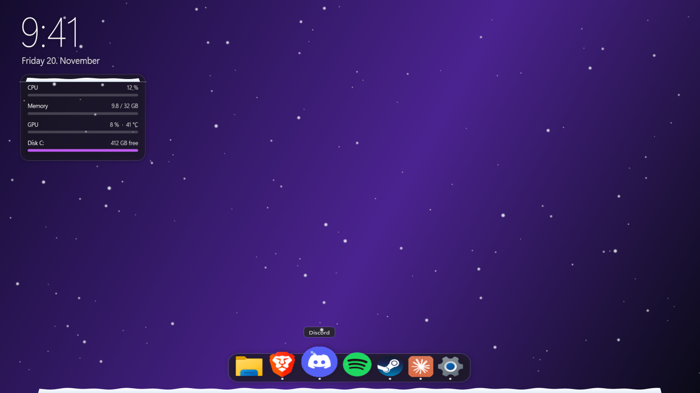
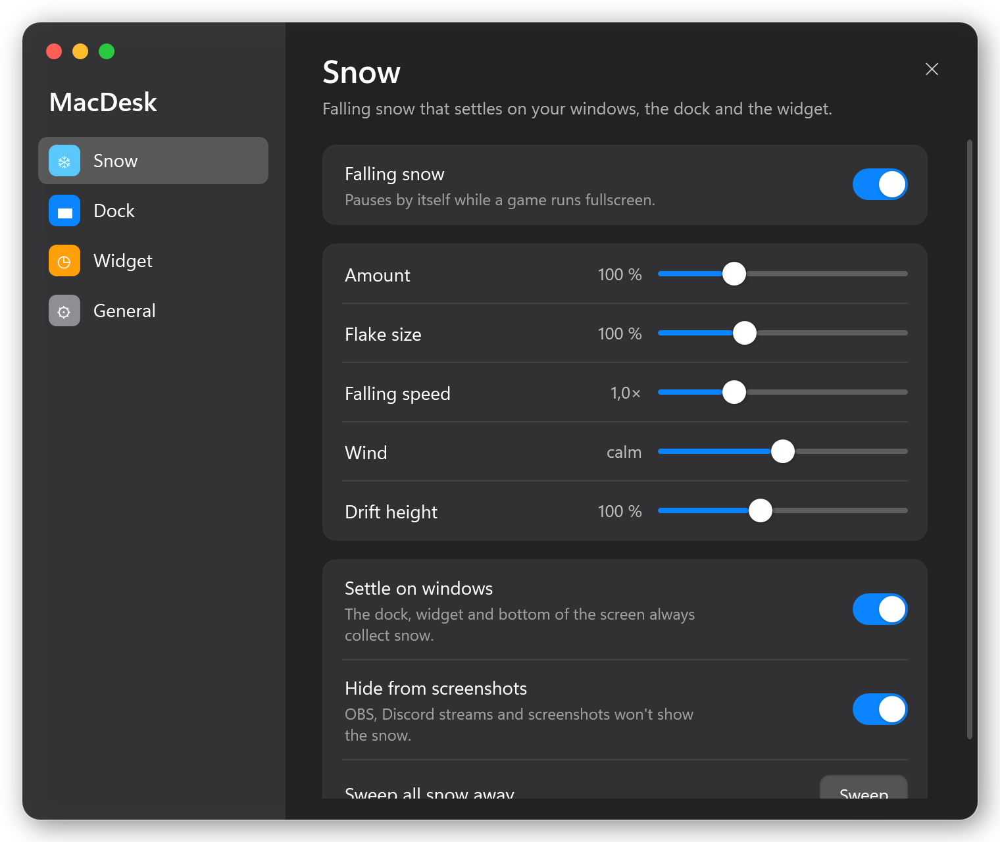

<div align="center">

# MacDesk

**A macOS-style dock, a desktop widget and falling snow for Windows 11.**<br>
One PowerShell script. Nothing to download, nothing to install, no admin rights.




</div>

## What you get

| | |
|---|---|
| **Dock** | Icons magnify under the cursor like on a Mac, with the app name above them and a dot under apps that are running. Click to open an app or switch to it. Works with normal apps, Microsoft Store apps and Steam games. |
| **Widget** | A big clock and date, plus live CPU, memory, GPU (with temperature on NVIDIA) and disk bars. It sits on the desktop, under your windows. |
| **Snow** ❄️ | Soft snow falls across all your screens and settles on the tops of windows, on the dock, on the widget and along the bottom of the screen. Move a window and the snow slides off. Sweep a drift aside with the cursor. |
| **Settings** | A settings window for the snow, dock and widget, with changes applied as you go. |
| **Stays out of the way** | Hides during fullscreen games and videos. The snow lets every click through, doesn't show up in screenshots or streams, and uses about 1 % CPU. |

## Settings

Right-click the dock and pick **Settings…**

<div align="center">

</div>

| Section | What you can change |
|---|---|
| **Snow** | On/off, amount, flake size, falling speed, wind, how high drifts can pile up, whether snow settles on windows, hiding it from screenshots, a power-saving mode (30 fps) and sweeping all snow away |
| **Dock** | Icon size, magnification, app names, running-app dots, which apps are in the dock |
| **Widget** | Show or hide the widget, the date and the stats |
| **General** | Start at sign-in, restart, quit |

Settings are saved in `settings.json` next to the script.

## Install

1. Download this repository (**Code → Download ZIP**) and unzip it, or `git clone` it.
2. Right-click `install.ps1` and choose **Run with PowerShell**.

MacDesk is copied to `%LOCALAPPDATA%\MacDesk`, added to startup and started.

For the full Mac look, also:
- turn on **Settings → Personalization → Taskbar → Taskbar behaviors → Automatically hide the taskbar**
- right-click the desktop and choose **View → uncheck Show desktop icons**

## Dock apps

On first run, MacDesk builds the dock from apps you have installed. To change it, open **Settings → Dock → Edit…**. This opens `apps.json`:

```json
{ "name": "Discord", "appid": "com.squirrel.Discord.Discord", "proc": "Discord" }
```

| Field | Meaning |
|---|---|
| `name` | Label shown on hover |
| `appid` | App ID from `Get-StartApps`, or a full path to an `.exe` |
| `proc` | Process name, used for the running dot and to switch to the app (optional) |
| `icon` + `run` | For games and links: an icon source (`.exe`) and what to open (e.g. `steam://rungameid/...`) |

See [`apps.example.json`](apps.example.json). To list app IDs:

```powershell
Get-StartApps | Sort-Object Name
```

After editing, pick **Settings → General → Restart**.

## How it works

- **`MacDesk.ps1`**: the dock, widget and settings window (WPF), and a little C# for icons, CPU/RAM stats and reserving screen space for the dock.
- **`Snow.cs`**: the snow, compiled when MacDesk starts. It runs on its own thread and draws into click-through layered windows, one per screen. It finds window edges with `EnumWindows` and paces frames with the compositor (`DwmFlush`) for smooth 60 fps. Only pixels that changed are redrawn. Snow that falls off or gets swept away keeps its volume, so it never multiplies.

Delete `Snow.cs` to remove the snow completely.

## Uninstall

Run `uninstall.ps1`. It stops MacDesk, removes it from startup and deletes `%LOCALAPPDATA%\MacDesk`.

## Notes

- MacDesk runs with `-ExecutionPolicy Bypass` for this one script only and doesn't change your system's PowerShell policy. As with any script, read the code before you run it.
- GPU stats need an NVIDIA card (`nvidia-smi` comes with the driver). Without one, the GPU row is hidden.
- Tested on Windows 11 24H2 with Windows PowerShell 5.1, on two monitors.
- The snow was inspired by [Snowhush](https://github.com/mbezruchko/Snowhush) for macOS. MacDesk's version is written separately and shares no code with it.

## License

[MIT](LICENSE)
